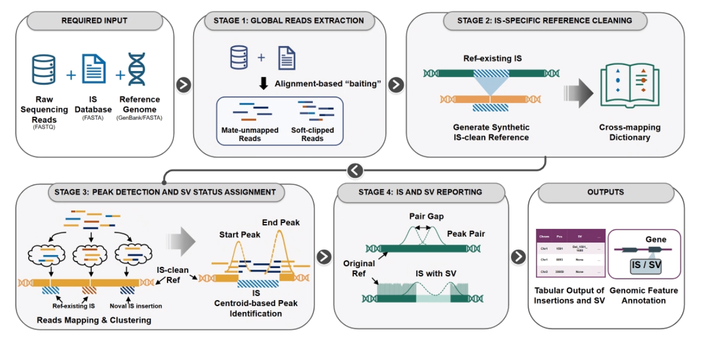

# ISdetector v1.1

**ISdetector** is a Python package designed to detect Insertion Sequences (IS) and associated Structural Variations (SVs) using paired-end or single-end Whole Genome Sequencing (WGS) data. It employs a hybrid strategy utilizing both discordant read pairs and split-read signals to identify novel insertion sites, known (reference) sites, and complex deletions.

## New in v1.1

* **Low-confidence calls:** retain singular peaks without a pairable counterpart and mark their reported positions with `\*`.
* **Configurable IS removal:** set `--identity` (minimum percent identity) and `--fraction` (minimum aligned length / IS length); defaults are 95 and 0.90, respectively. A BLAST hit must meet both thresholds to be removed.

## Table of Contents

* [Prerequisites](#prerequisites)
* [Installation](#installation)
* [Usage](#usage)
* [Workflow](#workflow)
* [Dataset](#dataset)
* [Arguments](#arguments)
* [Outputs](#outputs)

## Prerequisites

Install **Conda or Mamba** and make it available in `PATH`. Run the installer from Bash; it installs Python >=3.10, BWA, Samtools >=1.3, BLAST+, and all Python dependencies (`pysam`, `biopython`, `pandas`, `numpy`).

## Installation

```bash
git clone https://github.com/carolynzy/isdetector.git
cd isdetector
./install.sh
export PATH="$HOME/.local/bin:$PATH"
isdetector --version
```

Add the `export` line to `\~/.bashrc` (or your shell startup file) to keep the command available in future terminals. Run `isdetector --help` for usage. The launcher uses its dedicated environment automatically; no `conda activate` is needed.

The default environment is `\~/.local/share/isdetector/env`, and the launcher is `\~/.local/bin/isdetector`. Existing environments are never overwritten. To reinstall, choose a new prefix:

```bash
./install.sh --prefix "$HOME/.local/share/isdetector/env-new"
```

The managed launcher switches to the new environment after successful installation. Use `--launcher-dir /path/to/bin` to customize its location; environments and launchers must be outside the repository. Run `./install.sh --help` for all installer options.

For development, use `./install.sh --editable` and keep the repository in place. If managing dependencies yourself, use `python -m pip install .` with the required external tools in `PATH`. The installer saves tool paths inside its environment; direct pip installations discover tools from `PATH`.

## Usage

Run `isdetector` from any working directory once its launcher directory is in `PATH`. The launcher automatically runs the command in the dedicated environment, using the saved tool paths; no manual activation is needed.

**For Paired-End Reads:**

```bash
isdetector \\
    -1 data/reads\_R1.fastq.gz \\
    -2 data/reads\_R2.fastq.gz \\
    -i data/is\_elements.fasta \\
    -r data/reference\_genome.gb \\
    -s MySample \\
    -o ./results \\
    -t 16
```

## Workflow

<p align="center">
    
</p>

## Dataset

The test data and files used for evaluation is archived on Zenodo:
**DOI:** [https://doi.org/10.5281/zenodo.18996276](https://doi.org/10.5281/zenodo.18996276)

It could also be downloaded by running:

```bash
./download\_data.sh
```

which will create a folder "data" and download the test data automatically.

## Arguments

```bash
  -h, --help            show this help message and exit
  --version             Show program version and exit.
  -i IS\_DB, --is\_db IS\_DB
                        FASTA file of IS sequences (Bait).
  -r REFERENCE, --reference REFERENCE
                        Reference genome: FASTA (.fasta/.fa/.fna/.ffn/.fas/.fsa) or GenBank (.gb/.gbk); case-insensitive.
  -s SAMPLE, --sample SAMPLE
                        Prefix used for output files and log files.
  -o OUTDIR, --outdir OUTDIR
                        Directory for all outputs.
  -t THREADS, --threads THREADS
                        BWA/Samtools threads and Stage 3 worker processes (default: 16).
  --identity IDENTITY   Minimum BLAST identity percentage for reference IS removal
                        (0–100; default: 95.0).
  --fraction FRACTION   Minimum BLAST aligned-length / IS-length fraction for
                        reference IS removal (0–1; default: 0.90).
  --debug-fastq         Save Stage 1 extracted reads to file.
  --debug-signal        Save Stage 3 insertion signals to file.
```

Input Reads (Choose One Strategy):

```bash
  -1 FASTQ1, --fastq1 FASTQ1
                        Path to Raw Read 1 (FASTQ/GZ).
  -2 FASTQ2, --fastq2 FASTQ2
                        Path to Raw Read 2 (FASTQ/GZ).
  -f FASTQ, --fastq FASTQ
                        Path to Interleaved Paired-end FASTQ/GZ.
  -u UNPAIRED, --unpaired UNPAIRED
                        Path to Single-End FASTQ/GZ.
```

Reference IS removal evaluates each BLASTn hit separately: both `--identity` and `--fraction` must pass. For example, add `--identity 98 --fraction 0.95` to require at least 98% identity and an aligned length of at least 95% of the IS length. These options control reference cleaning, not call confidence.

Stage 3 uses up to `--threads` worker processes, limited by the number of clusters.
Each cluster is transferred as SAM strings; workers reconstruct reads and open
their own BAM handles for coverage queries. New clusters are submitted whenever
any task completes, so a slow earlier cluster does not prevent further submissions.
At most twice the worker count of tasks are in flight; completed results are
buffered as needed to retain the serial ordering
and detection rules. Use `--threads 1` for serial execution. More workers increase
memory use, and small workloads may be faster serially because worker startup and
read transfer add overhead. The pipeline profiler measures parallel Stage 3 wall
time and saves separate profiles inside workers. `worker\_breakdown.csv` reports
alignment, sorting, median, coverage, and SAM reconstruction times accumulated
across workers; these overlapping worker seconds must not be added to elapsed
wall time. `worker\_totals.csv` and `worker\_clusters.csv` show workload distribution
and task wall/CPU times. Normal runs do not enable worker profiling.

## Outputs

Each IS analysis writes `SAMPLE\_ISNAME\_report.tsv`. When no peaks are found, this file contains `No peaks detected.` instead of a table. Nonempty reports contain these columns, in order:

|Column|Description|
|-|-|
|Chromosome|Chromosome or contig in the original reference.|
|Position|Representative junction coordinate on the original reference, using zero-based boundary coordinates.|
|Gap|Absolute distance between paired peaks for non-SV calls; `NA` for SV or singular calls.|
|Orientation|IS orientation relative to the reference: `F` (forward) or `R` (reverse).|
|IS\_Length|Absolute difference between the paired peaks' IS coordinates; `NA` for singular calls.|
|Category|`Known`, `Known(SV)`, `Novel`, or `Novel(SV)`.|
|Start\_clipped|Number of right-clipped signals supporting the event.|
|End\_clipped|Number of left-clipped signals supporting the event.|
|Discordant|Number of non-proper paired alignment records in the representative peak's cluster. Single-end records are also counted here.|
|Proper|Number of proper-pair alignment records in the representative peak's cluster.|
|SV|Deletion interval, such as `Deletion\_150\_300`, when a deletion pair is identified; otherwise `None`.|

A position ending in an asterisk (for example, `12345\*`) marks a low-confidence call supported by a singular peak with no pairable counterpart. Support counts refer to alignment records or signals, not necessarily distinct read pairs. An `(SV)` category reflects a peak's depth-based status and can occur without an explicit deletion interval in `SV`.

When a GenBank reference is provided and annotations are generated, `SAMPLE\_ISNAME\_annotations.tsv` contains:

|Column|Description|
|-|-|
|Group\_ID|Identifier of the detected event grouping one or more peaks.|
|Position|Representative event coordinate on the original reference.|
|SV\_Type|Deletion interval if available; otherwise `None`.|
|Annotation\_Type|`Intragenic`, `Intergenic`, `Exonic (Deletion)`, or `Intergenic (Deletion)`. Annotation examines CDS features.|
|Gene|Gene name or locus tag for a CDS hit; affected genes for a deletion; or nearest upstream/downstream CDS labels and distances for an intergenic insertion.|
|Protein|Duplicates the `Gene` field; it is not a separate protein-name annotation.|
|Product|CDS product qualifier(s), or `NA` when unavailable.|

Stage 1 writes `SAMPLE\_IS\_extracted.fq` for each IS, assigning reads nonexclusively using BWA primary and alternative alignments (`-a -Y`). The existing clipping and mapped/unmapped-mate criteria are evaluated per IS; paired reads are kept together and written once per qualifying IS. Stage 2 uses only that IS’s FASTQ. IS sequences with no candidates receive a no-peaks report without alignment. With `--debug-fastq`, these FASTQs are retained; otherwise they are removed after processing. Paired-end output is interleaved; single-end output contains individual reads. Assignment is limited to alignments reported by BWA.

With `--debug-signal`, when peaks and signals are present, `SAMPLE\_ISNAME\_signals.tsv` contains:

|Column|Description|
|-|-|
|Chromosome|Contig name in the IS-clean reference, including its `\_clean` suffix.|
|Cluster\_id|Cluster identifier in the form `{chromosome}\_{start}\_{end}`, using IS-clean reference coordinates.|
|Read\_id|Read name from the alignment.|
|is\_read1|`True` for read 1, `False` for read 2; single-end reads are treated as read 1.|
|Position|Zero-based junction boundary on the IS-clean reference. Debug signals are not lifted back to original-reference coordinates.|
|IS\_coordinate|Zero-based alignment boundary on the IS sequence.|
|Clipped\_sequence|Soft-clipped sequence that matched the IS.|
|IS\_strand|`1` for a forward match or `-1` for a reverse-complement match to the IS.|
|Orientation|`F` (forward) or `R` (reverse).|
|Clip\_side|`LEFT` or `RIGHT`, identifying the soft-clipped end of the alignment.|

Pipeline progress and errors are written to `SAMPLE.log` and the screen. Intermediate alignment BAM files are removed after successful per-IS processing.

